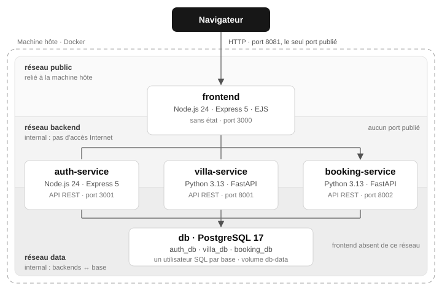

# Rapport de projet : Villa sur la Côte d'Azur

_Tristan Gerber · Master 2, Université de Strasbourg · module « Dév avec Docker » · octobre 2026_
_Dépôt : https://github.com/Tristan-stack/villa-cote-azur_

## 1. Architecture

Villa sur la Côte d'Azur est un site de location de villas. On peut créer un compte, parcourir les
villas, réserver des dates et annuler ses réservations. Un administrateur peut supprimer les
comptes standard. L'application tient dans cinq conteneurs : un frontend, trois backends qui
exposent une API REST en JSON, et une base PostgreSQL.

*Seul le frontend est joignable depuis l'extérieur. Les backends et la base sont sur des réseaux
internes.*

| Service | Technologie | Rôle |
|---|---|---|
| frontend | Node.js 24, Express 5, EJS | pages HTML, contrôle d'accès, appels aux backends |
| auth-service | Node.js 24, Express 5 | comptes, connexion, sessions, rôles |
| villa-service | Python 3.13, FastAPI | catalogue des villas |
| booking-service | Python 3.13, FastAPI | réservations |
| db | PostgreSQL 17 | une base par service |

- **Frontend sans état** : les sessions sont stockées en base par l'auth-service et le cookie ne
  contient qu'un jeton aléatoire. On peut redémarrer le frontend sans déconnecter personne.
- **Une base par service** : trois bases dans un seul PostgreSQL, chacune avec son utilisateur
  SQL. Un service ne peut ouvrir que sa propre base.
- **Pas de double réservation** : une contrainte d'exclusion PostgreSQL refuse deux séjours qui se
  chevauchent dans la même villa.
- **Sécurité** : mots de passe hachés avec bcrypt, requêtes SQL paramétrées, cookie `HttpOnly`.
- **Tests** : chaque service a ses tests unitaires (73 au total), sans base grâce à une version en
  mémoire, et un test de bout en bout vérifie l'application lancée par docker compose.

## 2. Dockerfiles et docker-compose

Les quatre Dockerfiles ont trois étapes (multi-stage build) : `deps` installe les dépendances,
`test` lance le lint et les tests unitaires, et `production` donne l'image finale, sans outils de
test. Si un test échoue, le build échoue. Bonnes pratiques appliquées :

- images officielles légères, à version fixe : Alpine pour Node.js, Debian slim pour Python, dont
  les paquets compilés sont prévus pour la glibc ;
- fichiers de dépendances copiés avant le code, pour profiter du cache ;
- utilisateur non-root, `HEALTHCHECK`, `CMD` en forme exec, `.dockerignore`, labels OCI ;
- aucun avertissement de hadolint.

Le `docker-compose.yml` lance tout avec `docker compose up -d --build --wait` :

- trois réseaux, `public`, `backend` et `data`, les deux derniers en `internal` : seul le frontend
  publie un port, et il n'a pas accès à la base ;
- un healthcheck par service et `depends_on` avec `service_healthy` : la base démarre d'abord, puis
  les backends, puis le frontend ;
- un volume nommé pour les données, et le script de création des bases monté en lecture seule ;
- des limites CPU et mémoire, le redémarrage automatique, un système de fichiers en lecture seule
  et aucune capability Linux, écrits une seule fois grâce à une ancre YAML.

Le même fichier sert pour les trois environnements, seules les variables changent. Si un secret
manque, le démarrage s'arrête avec un message clair (`${VAR:?}`).

| Environnement | Variables | Images | Port |
|---|---|---|---|
| TEST | `.env`, versionné, mots de passe factices | construites en local | 8081 |
| UAT | `env/uat.env`, non versionné | GHCR, tag `v0.1.0` | 8082 |
| PROD | `env/prod.env`, non versionné | GHCR, tag `v1.0.0` | 80 |

## 3. Git et CI/CD

Tout le projet est dans un seul dépôt public sur GitHub (monorepo) : un seul compose, un seul
pipeline, et un commit peut toucher plusieurs services. Le `.gitattributes` force les fins de
ligne LF, sinon le script d'initialisation de la base ne marche pas dans le conteneur.

Le pipeline GitHub Actions (`.github/workflows/ci.yml`) se lance à chaque commit et à chaque tag
poussés, et une fois par semaine pour refaire le scan de sécurité. Chaque étape attend la réussite
de la précédente :

1. **Tests** des 4 services en parallèle : hadolint, puis `docker build --target test`.
2. **Test de bout en bout** : l'application est lancée avec docker compose et vérifiée par le
   script de test.
3. **Publication** des 4 images : build de production, scan Trivy (échec si une faille critique
   corrigeable est trouvée), SBOM, puis push sur GitHub Container Registry (GHCR).

Si une étape échoue, aucune image n'est publiée. Les images sont taguées avec le nom du tag git
(`v1.0.0`) ou le SHA court du commit, jamais `latest`.

Mise en place : la CI se connecte à GHCR avec le `GITHUB_TOKEN` fourni par GitHub, donc il n'y a
aucun secret à créer, et seul le job de publication peut écrire dans le registre. GHCR refuse les
majuscules : le nom du compte est mis en minuscules dans le workflow. Le workflow est vérifié avec
actionlint, et les images publiées sont publiques.

## 4. Gestion de projet

J'ai réalisé le projet seul, du 28 au 30 octobre 2026, en sept étapes : dépôt Git et base de
données, auth-service, villa-service et booking-service, frontend, docker-compose et
environnements, pipeline CI/CD, puis interface et documentation. Chaque service avait son
Dockerfile et ses tests avant l'intégration avec docker compose, et chaque étape se terminait par
une vérification (tests, build, lancement réel) et un commit.

Outils : Git et GitHub (Actions, GHCR), VS Code, Docker Desktop sous Windows.

Usage de l'IA : le sujet tolère l'IA pour le code et la CI, et la déconseille pour les Dockerfiles
et le compose. J'ai utilisé un assistant IA (Claude, d'Anthropic), qui a écrit le code, les tests,
le pipeline, les Dockerfiles et le docker-compose.yml en suivant les conventions du cours. De mon
côté, j'ai choisi le thème, les langages et les outils, validé l'architecture, piloté les étapes
et vérifié chaque résultat sur mon poste et sur GitHub. Je me suis approprié chaque fichier pour
pouvoir l'expliquer.

## 5. Rétrospective

Difficultés rencontrées et solutions :

- **Ports déjà pris** : quatre PostgreSQL installés sous Windows occupaient les ports 5432 à 5435.
  Dans le compose final, la base ne publie aucun port, donc le problème ne se pose plus.
- **`localhost` en IPv6** : sous Windows, `localhost` passe d'abord par IPv6, alors que le port
  n'était publié qu'en IPv4, et le client PostgreSQL restait bloqué. Solution : `127.0.0.1` et un
  délai maximal de connexion de 10 s.
- **Git Bash** convertit les chemins comme `/admin/users` en chemins Windows. Le script de test
  désactive cette conversion avec `MSYS_NO_PATHCONV=1`.
- **Docker Hub parfois injoignable** (« TLS handshake timeout ») pendant les builds. Pour la démo,
  les images étaient construites la veille.

Ce qui a bien marché : les tests sans base, très rapides, et le test de bout en bout, utilisé en
local, dans la CI et pour répéter la démo.

Si c'était à refaire :

- utiliser les secrets Docker plutôt que des variables d'environnement ;
- mettre un reverse-proxy avec HTTPS devant le frontend ;
- gérer le schéma de la base avec un outil de migration ;
- promouvoir les images de TEST vers UAT puis PROD, avec une validation manuelle.
