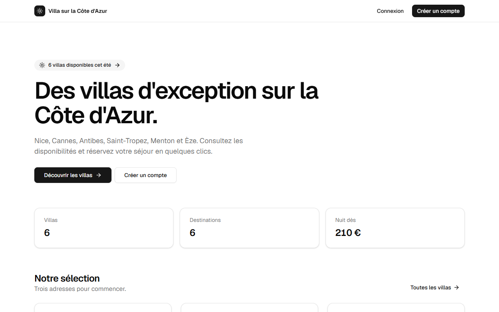
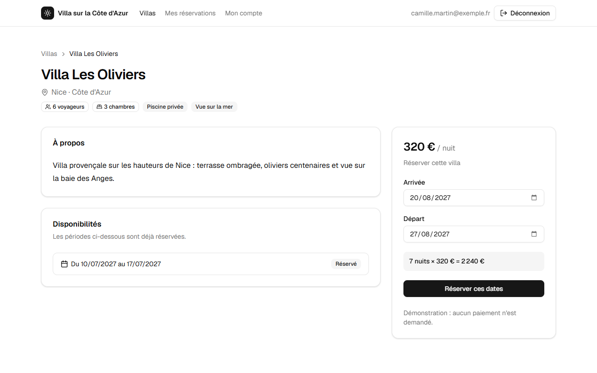
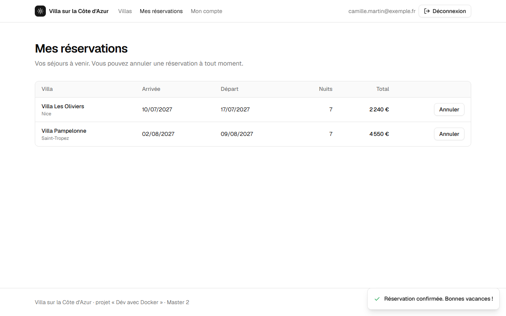
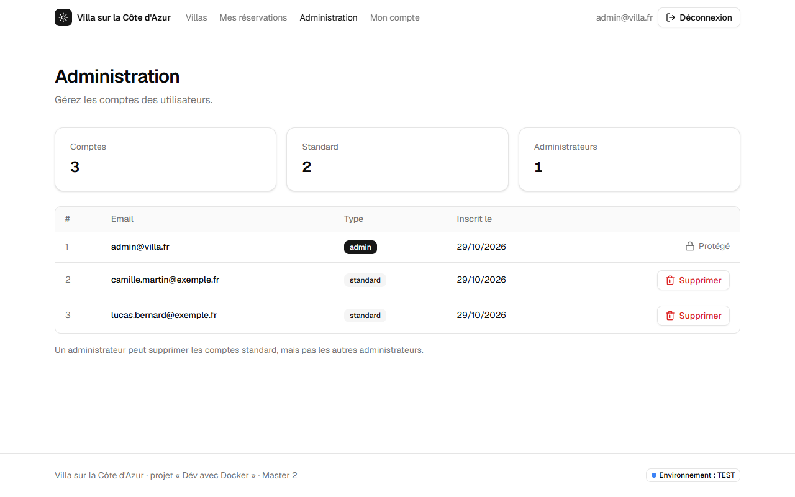
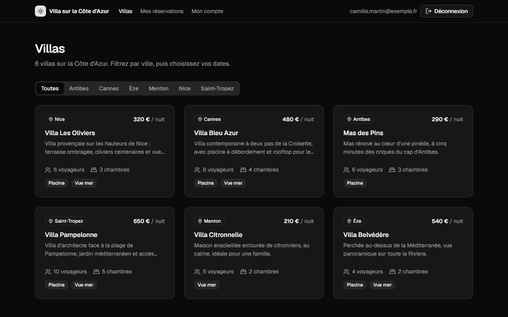

# Rapport de projet : Villa sur la Côte d'Azur

_Tristan Gerber · Master 2, Université de Strasbourg · module « Dév avec Docker » · octobre 2026_
_Dépôt : https://github.com/Tristan-stack/villa-cote-azur_

## 1. Architecture

### 1.1 Vue d'ensemble

Villa sur la Côte d'Azur est un site de location de villas. Un visiteur peut créer un compte,
parcourir les villas, réserver des dates et annuler ses réservations. Un administrateur peut
supprimer des comptes.

L'application est composée de cinq conteneurs : un frontend, trois backends et une base
PostgreSQL.

*Seul le frontend est joignable depuis l'extérieur. Les backends et la base sont sur des réseaux
internes.*

| Service | Technologie | Rôle |
|---|---|---|
| frontend | Node.js 24, Express 5, EJS | pages HTML, contrôle d'accès, appels aux backends |
| auth-service | Node.js 24, Express 5 | comptes, connexion, sessions, rôles |
| villa-service | Python 3.13, FastAPI | catalogue des villas |
| booking-service | Python 3.13, FastAPI | réservations |
| db | PostgreSQL 17 | une base par service |

Les backends exposent une API REST en JSON. L'interface reprend le style de shadcn/ui, réécrit en
CSS (sans React). Elle ne charge aucune ressource externe et la page d'accueil pèse environ 37 Ko.

### 1.2 Choix d'architecture

**Frontend sans état.** Le navigateur ne parle qu'au frontend, qui appelle les backends sur le
réseau interne. Les sessions sont stockées en base par l'auth-service et le cookie ne contient
qu'un jeton aléatoire. On peut donc redémarrer le frontend, ou en lancer plusieurs, sans
déconnecter personne.

**Une base par service.** Un seul conteneur PostgreSQL contient trois bases, chacune avec son
utilisateur SQL. Un service ne peut ouvrir que sa propre base. Il n'y a pas de clé étrangère entre
les bases : quand un compte est supprimé, le frontend demande aussi au booking-service de supprimer
ses réservations.

**Réservations.** Deux réservations d'une même villa ne peuvent pas se chevaucher. Une contrainte
d'exclusion PostgreSQL le garantit, même si deux demandes arrivent en même temps.

**Sécurité.** Les mots de passe sont hachés avec bcrypt et les requêtes SQL sont paramétrées. Le
cookie de session est `HttpOnly` et `SameSite=Lax`. L'inscription crée toujours un compte
standard, et le premier admin est créé au démarrage à partir de variables d'environnement.

### 1.3 Tests

Chaque service reçoit son accès aux données en paramètre (injection de dépendances). Dans les
tests unitaires, la base est remplacée par une version en mémoire : ils tournent en une seconde,
sans PostgreSQL. Il y a 17 tests pour l'auth-service, 8 pour le villa-service, 21 pour le
booking-service et 27 pour le frontend.

Le script `scripts/smoke-test.sh` teste aussi l'application complète lancée par docker compose,
avec 28 vérifications (parcours utilisateur et admin, chevauchement, frontend sans état, isolation
réseau).

### 1.4 Contraintes du sujet

| Contrainte | Réalisation |
|---|---|
| un frontend et au moins 3 backends, chacun dans un conteneur | frontend, auth-service, villa-service, booking-service |
| au moins 2 langages pour les backends | Node.js et Python |
| frontend sans état | sessions stockées en base par l'auth-service |
| API HTTP REST | API JSON |
| base de données SQL | PostgreSQL 17, avec un volume nommé |
| frontend joignable, backends et base non joignables | seul le frontend publie un port, les autres sont sur des réseaux internes |
| tests unitaires pour chaque backend | 17, 8 et 21 tests |
| comptes standard et admin, suppression de comptes | pages « Mon compte » et « Administration » |
| avant connexion, accès à l'accueil et à la connexion seulement | les autres pages redirigent vers la connexion |

## 2. Dockerfiles et docker-compose

### 2.1 Dockerfiles

Les quatre Dockerfiles suivent le même modèle, en trois étapes (multi-stage build) :

- `deps` installe les dépendances de production.
- `test` ajoute les dépendances de développement, puis lance le lint et les tests unitaires. Si un
  test échoue, le build échoue.
- `production` est l'image finale : le code et les dépendances de production, sans outils de test.

Bonnes pratiques appliquées :

- images officielles et légères, avec une version fixe (`node:24.22-alpine3.24`,
  `python:3.13-slim-trixie`), jamais `latest`
- fichiers de dépendances copiés avant le code, pour garder le cache quand seul le code change
- utilisateur non-root
- `HEALTHCHECK` sur la route `/health`
- `CMD` en forme exec : l'application reçoit le signal d'arrêt et s'arrête proprement
- `.dockerignore` et labels OCI

Les quatre Dockerfiles passent hadolint sans avertissement. J'ai pris Alpine pour Node.js, mais
Debian slim pour Python, car beaucoup de paquets Python compilés sont prévus pour la glibc de
Debian et pas pour Alpine.

### 2.2 docker-compose.yml

Toute l'application démarre avec une seule commande : `docker compose up -d --build --wait`.

- Il y a trois réseaux : `public` pour le frontend, `backend` entre le frontend et les backends,
  `data` entre les backends et la base. `backend` et `data` sont `internal`, sans accès à
  Internet. Seul le frontend publie un port, et il n'est pas sur le réseau `data`.
- Chaque service a un healthcheck. Avec `depends_on` et `condition: service_healthy`, la base
  démarre d'abord, puis les backends, puis le frontend.
- Les données PostgreSQL sont dans un volume nommé. Le script qui crée les bases est monté en
  lecture seule et ne s'exécute qu'au premier démarrage.
- Chaque conteneur a des limites CPU et mémoire, choisies avec `docker stats` : 25 à 45 Mo
  utilisés pour une limite de 256 Mo.
- Les conteneurs redémarrent seuls (`restart: unless-stopped`). Leur système de fichiers est en
  lecture seule, ils n'ont aucune capability Linux (`cap_drop: [ALL]`) et leurs logs tournent.

Les réglages communs à tous les services sont écrits une seule fois, avec une ancre YAML.

### 2.3 Environnements TEST, UAT et PROD

Le même `docker-compose.yml` sert pour les trois environnements, seules les variables changent :

- TEST lit `.env` : images construites en local, port 8081, mots de passe factices. Ce fichier est
  versionné pour que le projet démarre directement après un clone.
- UAT et PROD lisent `env/uat.env` et `env/prod.env`, passés avec `--env-file`. Ces fichiers ne
  sont pas versionnés. Ils utilisent les images publiées par la CI, désignées par leur tag.

Si un secret manque, le démarrage échoue avec un message clair (syntaxe `${VAR:?}`).

## 3. Git et CI/CD

### 3.1 Dépôt

Tout le projet est dans un seul dépôt public sur GitHub (monorepo). Pour un projet de cette
taille, c'est plus simple : un seul compose, un seul pipeline, et un commit peut modifier une API
et le service qui l'appelle. Le fichier `.gitattributes` force les fins de ligne LF, sinon le
script shell d'initialisation de la base ne marche pas dans le conteneur.

### 3.2 Pipeline

Le pipeline GitHub Actions se lance à chaque commit et à chaque tag poussés. Il tourne aussi une
fois par semaine pour refaire le scan de sécurité. Il a trois étapes :

1. Tests des 4 services en parallèle : hadolint, puis `docker build --target test` (lint et tests
   unitaires).
2. Test de bout en bout : l'application est lancée avec docker compose, puis le script de test
   fait ses 28 vérifications.
3. Publication des 4 images : build de l'image de production, scan Trivy (échec si une faille
   critique corrigeable est trouvée), SBOM, puis push sur GitHub Container Registry (GHCR).

Chaque étape attend la réussite de la précédente (`needs`). Si une étape échoue, le pipeline
s'arrête et aucune image n'est publiée. Les images sont taguées avec le nom du tag git (par
exemple `v0.1.0`) ou avec le SHA court du commit, jamais `latest`.

### 3.3 Mise en place

J'ai créé le dépôt sur GitHub, puis écrit le workflow `.github/workflows/ci.yml` en le vérifiant
avec actionlint. La CI se connecte à GHCR avec le `GITHUB_TOKEN` fourni par GitHub, donc il n'y a
pas de secret à créer. Seul le job de publication a le droit d'écrire dans le registre. GHCR
refuse les majuscules : le nom du compte (`Tristan-stack`) est mis en minuscules dans le workflow.
Les images publiées sont publiques et téléchargeables sans compte.

## 4. Gestion de projet

J'ai réalisé le projet seul, du 28 au 30 octobre 2026. Je l'ai découpé par composant :

1. dépôt Git et script d'initialisation de PostgreSQL
2. auth-service et son Dockerfile
3. villa-service et booking-service, avec leurs Dockerfiles
4. frontend
5. docker-compose.yml et environnements
6. pipeline CI/CD
7. interface et documentation

Chaque étape se terminait par une vérification (tests, build, lancement réel) et un commit. Chaque
service a été testé seul avant l'intégration avec docker compose.

Outils : Git et GitHub (Actions, GHCR), VS Code, Docker Desktop sous Windows.

Usage de l'IA : le sujet tolère l'IA pour le code et la CI, et la déconseille pour les Dockerfiles
et le compose. J'ai utilisé un assistant IA (Claude, d'Anthropic), qui a écrit le code, les tests,
le pipeline, les Dockerfiles et le docker-compose.yml en suivant les conventions du cours. De mon
côté, j'ai choisi le thème, les langages et les outils, validé l'architecture, piloté les étapes
et vérifié chaque résultat sur mon poste et sur GitHub. Je me suis approprié chaque fichier pour
pouvoir l'expliquer.

## 5. Rétrospective

### 5.1 Difficultés

- Des ports étaient déjà pris sur ma machine : quatre PostgreSQL installés sous Windows occupaient
  les ports 5432 à 5435, avec un message d'erreur trompeur (« accès interdit »). J'ai utilisé
  d'autres ports pour le développement. Dans le compose final, la base ne publie aucun port, donc
  le problème ne se pose plus.
- Sous Windows, `localhost` est d'abord résolu en IPv6, alors que le port n'était publié qu'en
  IPv4, et le client PostgreSQL restait bloqué. J'utilise `127.0.0.1` et un délai maximal de
  connexion de 10 s.
- Git Bash convertit les chemins comme `/admin/users` en chemins Windows. Le script de test
  désactive cette conversion avec `MSYS_NO_PATHCONV=1`.
- Le premier push vers GHCR a échoué, et le log détaillé n'était visible qu'en étant connecté. J'ai
  affiché l'erreur de Docker dans une annotation du pipeline. Le pipeline suivant a publié les
  images.
- Certains builds ont échoué parce que Docker Hub ne répondait pas (« TLS handshake timeout ») :
  avec `--build`, Docker l'interroge à chaque fois. Pour la démo, les images sont construites la
  veille et l'application démarre sans `--build`.

### 5.2 Ce qui a bien marché

L'injection de dépendances, qui donne des tests rapides sans base, et le test de bout en bout,
utilisé en local, dans la CI et pour répéter la démo.

### 5.3 Si c'était à refaire

- utiliser les secrets Docker plutôt que des variables d'environnement
- mettre un reverse-proxy avec HTTPS devant plusieurs instances du frontend
- gérer le schéma de la base avec un outil de migration (Alembic, node-pg-migrate)
- promouvoir les images de TEST vers UAT puis PROD, avec une validation manuelle

## Annexe : captures d'écran

Environnement TEST, navigateur Chrome.

*Accueil, avant connexion.*

*Fiche d'une villa : périodes réservées et calcul du prix.*

*Mes réservations.*

*Administration : les comptes admin sont protégés.*

*Catalogue en mode sombre.*
